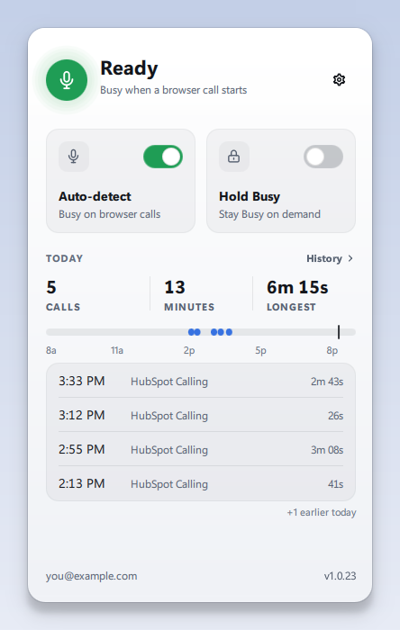

# Busy Buddy

Busy Buddy sets your Microsoft Teams status to **Busy · In a call** while you are on a call in your web browser (for example a HubSpot call), and puts it back when you hang up. Teams doesn't know about calls made in a browser, so people see you as Available while you are talking. This fixes that.

It lives in the Windows tray (the little icon by the clock). There is nothing to do during a call.

## What it does

- Watches whether a browser is using your microphone. While one is, it tells Teams you are Busy. When the microphone is free again, it clears that and Teams goes back to normal.
- Shows today's calls in a small panel when you click the tray icon.
- Lets you hold Busy by hand (15 minutes, 30 minutes, an hour, or until you turn it off).
- Updates itself.

It does not touch your calendar, mail, chats or files, and it does not listen to anything.

## Install

1. Download **BusyBuddy-Setup.exe** from the [latest release](https://github.com/codyrf1990/busy-buddy-releases/releases/latest) (under Assets).
2. Run it. Windows will probably show a blue "Windows protected your PC" box, because the installer isn't signed with a paid certificate. Click **More info**, then **Run anyway**. (You only see this once, at install. Later updates are silent.) On Windows 11 with Smart App Control turned on, Windows may block unsigned apps outright, with no "Run anyway" button; if that happens, ask IT.
3. The installer needs no admin rights. Leave "Start Busy Buddy when I sign in to Windows" ticked so it is always running.
4. When it opens, click **Sign in with Microsoft** and sign in with the **work Microsoft account you use for Teams**.

Windows 11 may put the new icon under the small arrow next to the clock. Drag it out, or use the "Keep on taskbar" button in the welcome window, so you can see it.

## The Microsoft sign-in page

Microsoft's page will say the app is called **Microsoft Graph Command Line Tools**, and it will ask permission to read and change your presence. This is expected. Busy Buddy borrows Microsoft's own public sign-in app so that it doesn't need its own registration with your company. The only data permission it asks for is `Presence.ReadWrite`: reading and changing your own Teams status. It cannot see other people's status, your mail, your calendar or your files. Microsoft's page may also list signing you in and keeping you signed in (it can show `openid`, `profile` and `offline_access`); those are not access to your data, and the exact wording on that page is Microsoft's.

Some companies don't allow users to approve apps themselves. If sign-in stops with a message that your company needs to approve this, send IT this: "Please allow Microsoft Graph Command Line Tools with the Presence.ReadWrite permission." The message on screen includes the Microsoft error code, which helps them.

IT can see this sign-in in the company's Microsoft sign-in logs, like any other app you sign in to.

## What it reads on your PC

- **Which programs are using the microphone.** It asks Windows' audio system which programs have a microphone open right now, and also reads the list Windows keeps for the microphone icon in the taskbar (a Windows registry list). It only learns which program it is, never the sound: it never records, captures or listens to audio.
- **Browser tab names and address bars, only while a browser is using the microphone.** Chrome, Edge, Brave, Comet, Vivaldi and Helium mark the tab that is using the mic ("... - Microphone recording"). While one of them holds the mic, Busy Buddy reads the tab names and the address bar text of the active tab in every window of those browsers (not only the one using the mic) to find that tab. That is the same information a screen reader can read. It never reads the content of a web page, and it does not look at tabs at any other time.
- **What it keeps from that.** The call history on your PC stores, for each call: start time, end time, the browser, and the **name (title) of the tab that was using the microphone**, for example "HubSpot Calling". A page decides its own tab title, so on some pages the title can include a name, such as the contact you are viewing. It is stored only on your PC, never sent anywhere, and kept for 90 days.
- If you tell Busy Buddy to ignore a site (Settings), that site's address is saved in your settings so it can recognise it next time, or the tab's title if the address wasn't known. A title can hold a name.

## What leaves your PC

Two kinds of traffic, and nothing else. There is no analytics, tracking or crash reporting.

1. **To Microsoft** (`login.microsoftonline.com`, `graph.microsoft.com`): signing in, and the calls that set your Teams status to Busy, renew it every few minutes during a call, clear it afterwards and read it back to check Teams agrees. If you turn on the optional extras, it also sends your status message text or Do Not Disturb. No call details, site names or tab names go to Microsoft.
2. **To GitHub** (`api.github.com`, `github.com`, `release-assets.githubusercontent.com`): once an hour it asks this page whether there is a newer version, and downloads it if so. GitHub sees your IP address, as with any web request.

Your Microsoft sign-in is kept on your PC in an encrypted file that only your Windows account can open.

You can see all of this in the app: **Settings > Help > Privacy**.

## Updates

Busy Buddy checks for a new version about once an hour and installs it quietly when you are not on a call and the panel is closed. After an update it shows a short "What's new". You don't need to do anything.

## Uninstall

Windows Settings > Apps > Installed apps > Busy Buddy > Uninstall. Busy Buddy is closed first, and it clears Busy before it goes. Uninstalling then removes the program and your saved Microsoft sign-in, and turns off starting with Windows.

What stays behind: the folder `%LOCALAPPDATA%\TeamsCallBusy` (paste that into File Explorer's address bar), with your settings, a log (times of calls and Busy changes, kept 90 days) and the call history, **including the tab names described above**. Delete that folder if you want all of it gone. Only if Busy Buddy couldn't clear Busy (for example the network was down) does Teams keep showing Busy for up to 10 minutes, and then it clears by itself.

## Problems

Tell Cody Fraser. The tray icon's right-click menu has **Open log**, which shows what the app has been doing.
